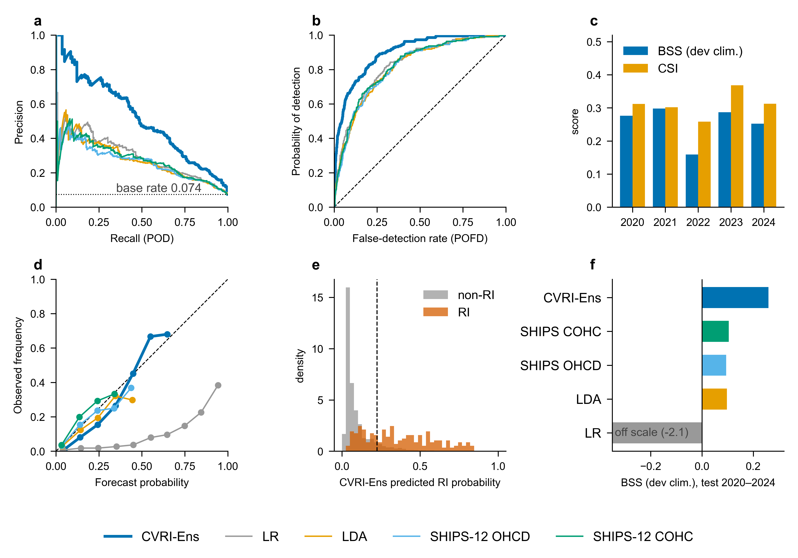

# CausalVisionRI — causal-prior deep learning for 24-h RI warning in the western North Pacific

Source release for the study *"Causal-prior-constrained deep learning for
rapid-intensification warning of western North Pacific tropical cyclones"* —
code, the derived data record, and the final artwork.  The paper and
supplementary material are distributed separately.  See `docs/README.md` for
the current documentation.

The system fuses three input streams — satellite infrared imagery, ERA5
environmental fields and a causal graph discovered from the observations — with
a gated cross-attention trunk, and constrains training with the discovered
structure and eight sign-verified causal effects.  It is evaluated under a
frozen, leakage-protected holdout: **fit 2000-2017 / inner 2018-2019 / test
2020-2024**, 3,004 test rows, learned on 12,619 fit rows and selected on 1,818
inner rows only.

Headline: **BSS_dev = 0.259** on the 3,004-row test set (fixed 2000-2019
development rate 0.0791), against 0.105 (SHIPS-12 LDA COHC), 0.095 (SHIPS-12
LDA OHCD), 0.098 (21-predictor panel LDA) and −2.074 (uncalibrated LR), all four
evaluated on identical rows with the same threshold-selection rule.



---

## 1. Figure and table map — every exhibit to the script that draws it

The artwork ships here, not in a paper: `figures/` holds the two
hand-drawn exhibits and the README overview; `data/analysis/` holds
everything computed after the data packages are extracted.  The mapping
from each exhibit to the artefact behind it is in `docs/SM_MAP.md`.

| item | shipped as | content | script | needs |
|---|---|---|---|---|
| **Fig. 1** | `figures/fig1_causal_discovery.{pdf,png}` | discovered causal graph (contemporaneous + lagged panels) | `scripts/07_figures/make_fig1_causal_discovery.py` | CPU, 3 s |
| **Fig. 2** | `figures/fig2_architecture.{pdf,png}` | architecture schematic | `scripts/07_figures/make_fig2_architecture.py` | CPU, 1 s |
| **Fig. 3** | `data/analysis/figures_pub/fig_main_overview.*` | main overview 2×3: PR, ROC, yearly BSS/CSI, reliability, probability distributions and BSS comparison | `scripts/07_figures/make_all_figures_pub.py` | CPU, 6 s |
| **Fig. 4** | `data/analysis/figures_pub/fig_causal_year_gradient.*` | per-year causal-gain gradient: ΔBSS (M0 − C2) per year, starred where the bootstrap CI excludes zero at both 90 % and 95 %, plus the same contrast for the five members | `scripts/07_figures/make_fig_causal_year_gradient.py` | CPU, 5 s |
| **Fig. 5** | `data/analysis/compare/fig_operating_points.*` | operating points vs external schemes | `scripts/07_figures/make_final_comparison_figures.py` | CPU, 20 s |
| **main table** | `data/analysis/eval/*.json` | CVRI-Ens vs four baselines + bootstrap ΔBSS with Holm | `scripts/05_eval/eval_holdout.py`, `compare_models_consistent.py` | CPU, 5 s |
| **ablation table** | `data/analysis/eval/M0_*.json` (`paired_bootstrap`) | 40 member×condition contrasts | `scripts/05_eval/eval_holdout.py` + `scripts/05_eval/make_sm_tables.py` | CPU, 2 s |
| **Generated Tables S1-S9** | `data/analysis/sm_tables.tex` | ATE panel, per-year, ensemble size, SHIPS-12, 22-arm ranking, ablations, sample census, label control, gate; S10 is handwritten in the SM source | `scripts/05_eval/make_sm_tables.py` | CPU, 2 s |
| **Supplementary Figs. S1-S6** | `data/analysis/figures_pub/`, `data/analysis/compare/` | selection landscape, member–ensemble gain, PR/ROC, CMA label control, 2020–2021 ablation forest and gate diagnostics | `make_all_figures_pub.py`, `compare_models_consistent.py` | CPU |
| **RITCF diagnostics** | `data/ritcf_recon/summary_*.md`, `sweep_table*.csv` | reconstruction comparison | `scripts/ritcf_recon/` (see its `README.md`) | GPU to retrain |

`make_all_figures_pub.py` writes ten analysis figures: the main overview, five
SM panels (S1, S2, S4, S5, S6), the full-period and two single-year ablation
forests, and the score distributions. `compare_models_consistent.py` writes the
two S3 curve panels separately, and `make_fig_causal_year_gradient.py` draws
main-text Fig. 4; `docs/SM_MAP.md` gives the exact source file behind each number.

## 2. Quick verification — all reported metrics on CPU in about two minutes

You need `record1_core.zip` (see §7) extracted into this directory, then:

```bash
# 1. audit chain: lock self-hashes, the selection→final→receipt chain, every
#    pinned artefact hash (see protocol_locks/asset_sha256_manifest.json), and
#    "no build-machine path survived" — text and parquet/npz/pkl binaries  (~20 s)
python tests/verify_protocol_locks.py

# 2. the headline number, recomputed from the frozen predictions only  (~2 s)
python scripts/05_eval/eval_holdout.py \
    --config configs/phase2/holdout_masked_v1.yaml \
    --pred  data/test/holdout_masked_v1/main.npz \
    --lock  protocol_locks/final.json \
    --out   /tmp/eval_main
#   n=3004  BSS_dev 0.258973  ROC_AUC 0.899712  PR_AUC 0.517783
#   POD 0.680  FARate 0.095  FARatio 0.635  CSI 0.311   (threshold 0.225)

# 3. shared-sample comparisons with the reference systems  (~10 s)
python scripts/06_compare/compare_models_consistent.py

# 4. ten analysis figures from this script, regenerated from released tables (~6 s)
#    (the CMA panel reads table_figA_best_auc.csv by default, see
#     docs/KNOWN_ISSUES.md §10)
python scripts/07_figures/make_all_figures_pub.py

# 5. the SM tables                                             (~2 s)
python scripts/05_eval/make_sm_tables.py

# 6. the whole test suite
python -m pytest tests/ -q
```

There is no training, no network access and no GPU in any of the above; steps
1-5 together take well under two minutes on a laptop.  The regenerated PNGs are
**byte-identical** to the shipped ones (the PDFs differ only in the matplotlib
timestamp) — that is the strongest reproducibility statement this release can
make without shipping weights.  `fig_cma_label_control` is the one panel that
depends on which comparison table it reads; it defaults to
`table_figA_best_auc.csv`, and setting `CMP_TABLE_SUFFIX` to anything else
(e.g. an empty string) switches it to that table instead
(`docs/KNOWN_ISSUES.md` §10).

## 3. Full reproduction route

Every stage is a script under `scripts/<NN_stage>/`.  Run everything **from this
directory**; all paths are relative to it.

| # | stage | command | hardware | wall clock (producing machine) |
|---|---|---|---|---|
| 0 | raw inputs | `scripts/01_data/download_hursat.py`, `download_cmems_ohc.py`, `src/wpac_causal/download*.py` | CPU + network | days (≈3,800 HURSAT archives, ERA5/GLORYS per storm) |
| 1 | best track + panel | `scripts/02_causal/main.py --config configs/phase1/config_alltc_0024.yaml` | CPU | ~2 h |
| 2 | global frame store | `scripts/01_data/download_global_hursat.py` → `build_hursat_qc.py` | CPU | ~10 h (155k frames, 195 GB) |
| 3 | **causal discovery + priors** (fit only) | `scripts/02_causal/run_holdout_fit0017.py` | CPU | **3.5 h** (PCMCI+ 2.9 h + effects 0.5 h) |
| 3b | sensitivity variants (strict, no-OHC, MJO-ENSO, LAT) | `scripts/02_causal/run_holdout_fit0017_sensitivity.py` | CPU | **5 h** (strict 3.5 h, no-OHC 1.6 h, adjustments 20 s) |
| 4 | phase-2 asset build + validation | `scripts/03_assets/build_holdout_assets.py` | CPU | 12 min |
| 5 | SHIPS-12 predictor table | `scripts/01_data/baseline_ships12.py --recompute` | CPU | 40 min |
| 6 | MAE memmap caches | `scripts/01_data/build_mae_cache.py`, `merge_global_cache.py` | CPU | 1.5 h |
| 7 | **MAE pretraining** (400 epochs WNP + global) | `scripts/03_assets/pretrain_mae.py --config configs/phase2/holdout_masked_v1.yaml` (WNP); append `--population global` for the global route | **GPU (≥24 GB)** | 2 × ~9 h |
| 8 | frozen-backbone embedding caches | `scripts/03_assets/precompute_frame_embeds.py` ×3 | GPU | 1.5 h |
| 9 | **22 arms** (30 pretrain + 40 finetune epochs each) | `scripts/04_train/run_holdout_arms.py --jobs 4` | **GPU (96 GB ⇒ 4 parallel)** | **~30 h** (jobs=4) |
| 10 | **inner-only ensemble selection** | `scripts/04_train/holdout_select.py` → `protocol_locks/selection.json` | CPU | 3 min |
| 11 | **40 ablations** (inner only) | `scripts/04_train/run_holdout_ablations.py` | **GPU** | ~10 h |
| 12 | baselines (LR/LDA, inner only) | `scripts/04_train/baseline_lr.py` | CPU | 5 min |
| 13 | **final lock** | `scripts/04_train/finalize_holdout.py --selection protocol_locks/selection.json --out protocol_locks/final.json` | CPU | 2 min |
| 14 | **one test inference pass** | `scripts/05_eval/test_infer.py --lock protocol_locks/final.json --out-dir data/test/holdout_masked_v1` | GPU | 45 min (49 entities) |
| 15 | metrics, gate, ablations, comparison | `eval_holdout.py`, `gate_analysis.py`, `ablation_worst_year.py`, `ablation_year_gradient.py`, `compare_models_consistent.py` | CPU | 15 min |
| 16 | figures + SM tables | `scripts/07_figures/*`, `scripts/05_eval/make_sm_tables.py` | CPU | 1 min |

The final 40 holdout contrasts are the `paired_bootstrap` blocks in
`data/analysis/eval/M0_*.json`, tabulated by `make_sm_tables.py`.
The current 40-contrast holdout panel is tabulated by `make_sm_tables.py`.

Total for the full chain from raw data: roughly **3 GPU-days plus 30 CPU-hours**.
Steps 0-3b and 7-11 are the only expensive ones; if you only want to check the
reported numbers, stop after step 2 of §2.

Stages 13-14 are the point of no return: the lock is written once and the test
split is inferred once.  `holdout_select.py`, `finalize_holdout.py` and
`test_infer.py` all refuse to run when a completed receipt already exists, and
changing `--out` or `--test-output-dir` does not reset that guard.

RITCF reconstruction (the comparison route) is a separate, self-contained
pipeline under `scripts/ritcf_recon/` — GPU, ~5.5 h for six 60-epoch arms; see
its `README.md`.

## 4. Protocol lock audit chain

```
selection.json ──(selection_sha256)──► final.json ──(lock_sha256)──► test_receipt.json
                                            │                              │
                                            └──────► 53 frozen npz ◄───────┘
```

* `protocol_locks/selection.json` — the 22-arm inner ranking, the family gate and
  the Top-5 membership.  Inner years only; the test split is not read.
* `protocol_locks/final.json` — the total lock: 49 inference entities, the
  threshold (0.225), the evaluation contract (BSS_dev primary, storm-cluster
  paired bootstrap ×2000, α=0.10, Holm over pre-declared complete families),
  and the SHA-256 of every artefact it depends on.
* `data/test/holdout_masked_v1/test_receipt.json` — `status: completed`, one
  entry per entity with the npz hash.  `eval_holdout.py` refuses to score
  anything whose receipt is missing, running, or bound to another lock.
* `protocol_locks/comparison_secondary{,_best_auc,_best_loss,_last}.json` —
  secondary analyses over the frozen predictions, one per RITCF checkpoint
  selection kind; each records the row-key hash of its sample definition and
  its relation to the official 3,004-row table.

**Release re-issue.** The locks were produced on the training host with absolute
paths.  For publication their path fields were rewritten to release-relative
paths (393 rewrites in `final.json`, 107 in the receipt) and `lock_sha256` was
recomputed; the predecessor digest is kept in
`final.json.release_reissue.superseded_lock_sha256`, and frozen npz files are
accepted under exactly `{new, superseded}` and nothing else
(`wpac_warning.protocol.accepted_lock_sha256`).  No numeric value changed.
`docs/PROTOCOL.md` §7 states this in full; `tests/verify_protocol_locks.py`
checks it.

## 5. Data dictionary

`docs/DATA_DICT.md` documents every column of every released table: the 17,655 ×
42 analysis panel, the imputation mask, the imputation/split/sample manifests,
the causal prior bundle (graph, ATE, CATE, headroom/regime, identification
status, refutation report, DAG audits, trusted signs), the four sensitivity
variants, the 53 frozen npz files and their keys, the analysis products, and the
RITCF record.  §8 of that file lists exactly what is **not** redistributed (raw
ERA5/GLORYS/HURSAT fields, the 195 GB frame store, deep-learning `*.pt`
checkpoints, the two multi-GB RITCF caches) and the command that rebuilds each.
Fitted LR, LDA and SHIPS-12 `model.pkl` baselines are included.

## 6. Running notes

```bash
# required on Windows/conda when torch and mkl-sharing libs are in one process
export KMP_DUPLICATE_LIB_OK=TRUE

# every figure script forces the Agg backend before importing pyplot;
# keep matplotlib.use("Agg") first if you edit them
```

* **`adjustText` is not required** by the current figure scripts; label layout
  and collision checks are implemented directly in the scripts.
* **Arial**: the figure scripts request it.  On Linux install
  `ttf-mscorefonts`; the fallback changes fonts, not layout.
* **`tcpyPI`** is optional (potential-intensity ceiling in the SHIPS baseline).
* **LingBot** is an external checkpoint, not a pip package; the self-trained
  ViT-MAE route needs nothing beyond `torch`.
* Run from the release root — the configs and the scripts resolve `data/…`
  relative to it.
* `python -m scripts.ritcf_recon.<module>` (module form, not the file path) is
  how the RITCF package expects to be invoked.

## 7. Data record

Two packages in the [Zenodo data record](https://doi.org/10.5281/zenodo.23768442)
accompany this repository and unzip **into this directory**:

| package | contents | size |
|---|---|---|
| `record1_core.zip` | panel + manifests + imputation mask + transformers, causal prior bundle, 4 sensitivity variants, 53 frozen test npz + receipt, analysis products, figures, protocol locks, SHIPS-12 tables | see `PACKAGE_record1_core.json` inside the zip |
| `record2_ritcf_recon.zip` | RITCF sample frame, pair tables, normalisation, dataset manifest, per-run audit trail, operating-point sweeps and summaries | see `PACKAGE_record2_ritcf_recon.json` inside the zip |

Each zip carries a record-specific `DATA_MANIFEST_<record>.sha256` file
(`sha256sum -c` compatible) and a matching `PACKAGE_<record>.json` inventory.  `era5.npy` (1.34 GB) and `sat.npy` (6.32 GB) are
deliberately excluded — `data/ritcf_recon/ACQUIRE.md` records their shape,
dtype and the rebuild command.

## 8. Licence and citation

* **Code** — MIT, see `LICENSE-CODE`.
* **Data record** — CC BY 4.0, see `LICENSE-DATA`.  Derived quantities only:
  raw ERA5 / GLORYS12V1 / IBTrACS / HURSAT-B1 fields and all deep-learning
  checkpoint weights are not redistributed.  Fitted LR, LDA and SHIPS-12
  `model.pkl` baselines are included.
* **Citation** — `CITATION.cff` (author list as it appears on the article).
  Please cite both the article and this data record.

## 9. Repository layout

```
typhoon-ri/
├─ README.md  LICENSE-CODE  LICENSE-DATA  CITATION.cff
├─ requirements/{phase1.txt, phase2.txt}
├─ configs/{phase1/*.yaml, phase2/*.yaml}
├─ src/
│  ├─ wpac_causal/     phase-1 library: best track, ERA5/OHC extraction,
│  │                   masked PCMCI+, DoWhy effects, identification policy
│  └─ wpac_warning/    phase-2 library: models, datasets, frame store,
│                      protocol/locks, evaluation, training loop
├─ scripts/
│  ├─ 01_data/         acquisition, QC, SHIPS-12 predictors, MAE caches
│  ├─ 02_causal/       phase-1 pipeline + sensitivity variants
│  ├─ 03_assets/       phase-2 asset build, MAE pretraining, embedding caches
│  ├─ 04_train/        22 arms, selection, 40 ablations, finalisation, baselines
│  ├─ 05_eval/         one-shot test inference, metrics, gate, ablations, SM tables
│  ├─ 06_compare/      consistent comparison engine + RITCF drivers
│  ├─ 07_figures/      all figures (main + SM + phase-1 companion)
│  └─ ritcf_recon/     self-contained RITCF reconstruction
│                      (8 modules + README)
├─ protocol_locks/     selection / final / comparison locks + receipt
├─ docs/               README, PROTOCOL, REPRODUCE, RESULTS, COMPARISON,
│                      DATA_DICT, SM_MAP, KNOWN_ISSUES + technical guides
├─ figures/            hand-drawn exhibits and the README overview
└─ tests/              verify_protocol_locks.py, test_release.py
```
